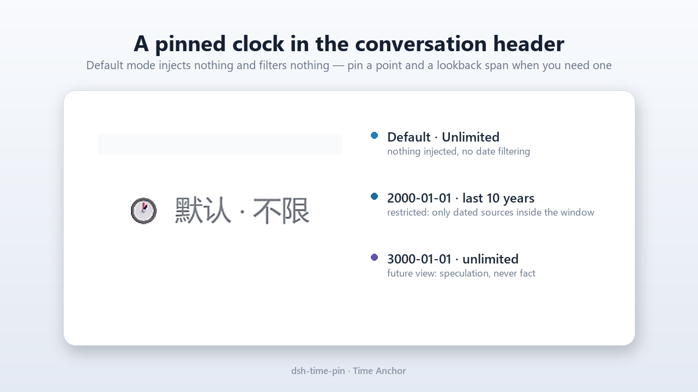
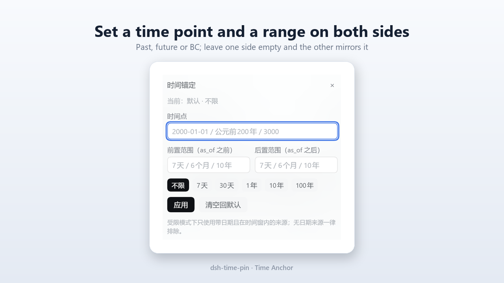
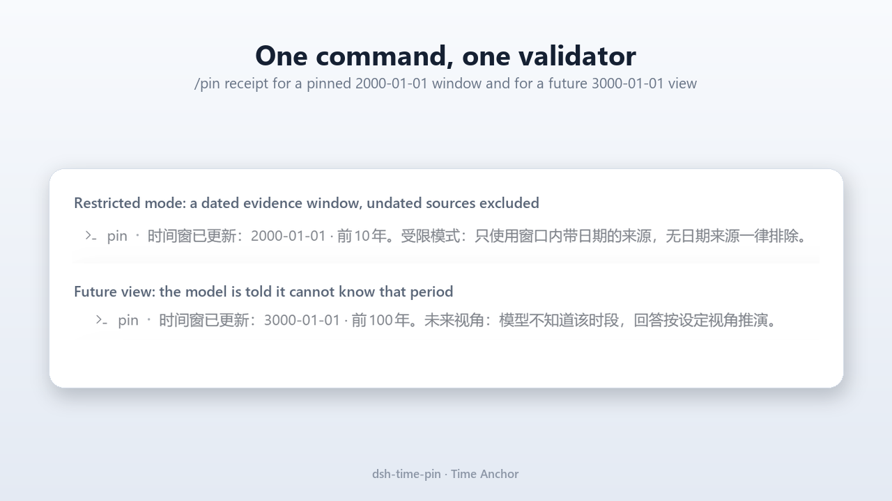
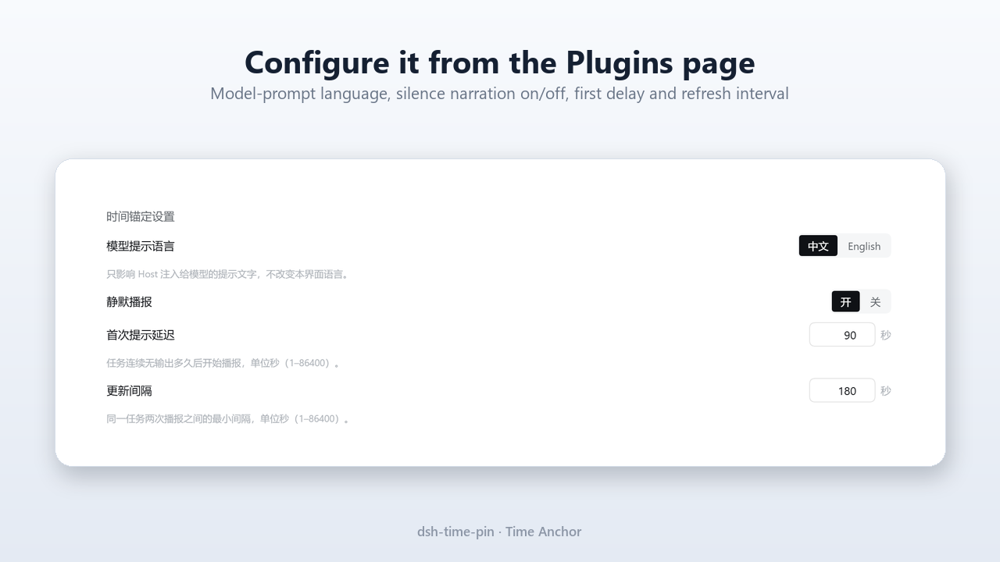

# dsh-time-pin · 时间锚定 · Time Anchor

[English](README.md) | 中文

`npm` [dsh-time-pin@0.1.0](https://www.npmjs.com/package/dsh-time-pin) ·
`GitHub` [HenryHe520/dsh-time-pin](https://github.com/HenryHe520/dsh-time-pin)

**把 AI 的“现在”钉在你选的时间点，并给对话划出一个只能往前看的取证窗口——过去、未来或公元前都可以，而不是让它用今天的知识回答历史问题。**

时间锚定（Time Anchor）给每个 DSH 会话加上一组会话级时间参数：一个 **as-of 时间点**和一个**检索范围**（拆成 as-of 之前、之后两侧），两者组成取证窗口 `[as_of − 前, as_of + 后]`。进入**受限模式**后，插件会在窗口变化时告诉智能体：本会话以哪个窗口为准、证据规则是什么；`web_search` 的检索结果会被过滤成**窗口内、带日期**的来源；模型的第一条回复必须确认当前时间窗。另一项能力为长时间无输出的**后台任务**提供确定性的 `[TIME FACT]` 播报。在默认的时间窗口模式下，插件不注入、不过滤任何内容；静默播报是独立功能，默认开启、与时间窗口无关，可在插件配置里关闭。

> **诚实声明：这是“证据隔离”，不是“模型失忆”。** 模型仍可能知道 `as_of` 之后发生的事；时间锚定约束的是“什么能当证据用”，并要求模型声明自己的窗口，但它无法抹掉训练知识，也不承诺零泄露。请以引用来源为准，而不是模型的自信程度。

[](icon.svg)

## 目录

- [截图](#截图)
- [它做什么](#它做什么)
- [安装](#安装)
- [快速开始](#快速开始)
- [`/pin` 命令](#pin-命令)
- [行为说明](#行为说明)
- [配置](#配置)
- [静默任务](#静默任务)
- [模型侧工具](#模型侧工具)
- [隐私与安全](#隐私与安全)
- [兼容性](#兼容性)
- [实现原理](#实现原理)
- [与相邻插件的对比](#与相邻插件的对比)
- [卸载与升级](#卸载与升级)
- [已知限制](#已知限制)
- [开发](#开发)
- [许可](#许可)

## 截图



*默认模式不注入、不过滤；标题栏控件始终显示当前状态。*



*pin 一个时间点加一个前后检索范围；面板提交的就是用户能直接输入的 `/pin` 命令。*



*`/pin` 回执：受限的历史窗口（只使用带日期来源）与未来视角（推演，不当事实）。*



*插件 → 已安装 → dsh-time-pin → 配置。*

## 它做什么

| 能力 | 你会得到什么 |
|---|---|
| **可 pin 的时间窗** | 对话标题栏控件（以及 `/pin` 命令）按会话固定 `as_of` 与前后检索范围；默认、过去、未来、公元前纪年都合法。 |
| **证据纪律** | 受限模式下模型会收到“哪个窗口算数”的指令，必须注明来源日期，必须把无日期与窗口外材料视为不可用，并在窗口内没有可用证据时如实说明。 |
| **过滤后的检索证据** | `web_search` 中无日期的来源、以及落在 `[as_of − 前, as_of + 后]` 之外的来源会被剔除，模型会收到一行说明，知道排除了什么、为什么。 |
| **锚定确认（anchor echo）** | 进入或修改受限窗口后，模型的第一条回复必须以一行确认当前时间窗；缺失时会收到一次纠正，且永远不会阻塞对话。 |
| **静默任务播报** | 后台任务 90 秒无输出（此后每 3 分钟）会生成确定性的 `[TIME FACT]`，模型可以据此播报——不用猜“还在跑吗”。 |

## 安装

要求：DSH `0.2.1-rc.x`（在 `0.2.1-rc.5` 上构建并验证）、Node.js `>= 20`；标题栏控件需要 Web/Desktop 版 DSH profile。Host 部分（命令、注入、证据过滤、静默播报）在任何交互式 profile 中可用。

### 从本地路径安装

```sh
git clone <本仓库> dsh-time-pin
dsh plugin --profile desktop add /absolute/path/to/dsh-time-pin
```

### 从 Git 地址安装

```sh
dsh plugin --profile desktop add https://github.com/<owner>/dsh-time-pin
```

### 从 npm 安装

已发布到 npm（包名 `dsh-time-pin`，`latest` = `0.1.0`）：

```sh
dsh plugin --profile desktop add dsh-time-pin
```

同样的三种形式也可以走 Web 界面：**设置 → 插件 → 添加插件**，然后粘贴包名、Git 地址或本地绝对路径。安装后，插件的**配置**页可从 **插件 → 已安装 → dsh-time-pin** 打开（见[配置](#配置)）。

> **安装/升级后需重启一次 DSH。** Host 部分（以及它的配置控件）在重启 DSH 一次后才生效，因为 Host 模块不支持热重载。这次重启之后，设置改动即时生效，标题栏 chip 与 `/pin` 在每个新对话里立即可用；如果 chip 没出现，刷新页面即可。

> 插件不会全局启用，而是装进某一个 profile。请用你实际聊天的那个 profile 名（例如 `web` 或 `desktop`）。

## 快速开始

1. 安装插件并重新加载对话界面。对话标题栏会出现时间锚定 chip：`🕐 默认 · 不限`（英文界面下为 `🕐 Default · Unlimited`），表示默认模式、不做过滤。
2. pin 一个窗口——点开 chip 面板填写，或直接输入命令：

   ```text
   /pin 2000-01-01 10年
   ```

   chip 变为 `🕰 2000-01-01 · 前后各10年`（英文界面：`🕰 2000-01-01 · ±10 years`）。只给一边时另一边自动等值，所以窗口是 1990-01-01 至 2010-01-01。在默认的 `promptLocale: zh` 下，命令回执为“时间窗已更新：2000-01-01 · 前后各10年”，并说明受限模式规则；想要英文回执可设 `promptLocale: en`。
3. 正常提问（例如“2000 年初做互联网，哪里是风口？”）。下一次模型请求会带上时间窗说明块；在 `promptLocale: zh` 下，回复必须以 `时间窗：2000-01-01 · 前后各10年` 开头（`en` 下为 `Time window: 2000-01-01 · ±10 years`），`web_search` 结果会被过滤到 1990-01-01 至 2010-01-01 之间、带日期的来源。
4. 用完清空：

   ```text
   /pin off
   ```

   chip 回到 `🕐 默认 · 不限`，模型会收到一次“证据窗口已清空”的通知。

模型提示语言与静默播报阈值可在插件界面的**配置**页修改——见[配置](#配置)。

其他值得先试的用法：

| 命令 | 结果 |
|---|---|
| `/pin` | 显示当前模式与窗口（别名：`/pin status`）。 |
| `/pin 2000` | pin 到 2000 年 1 月 1 日，保留当前检索范围。 |
| `/pin 2000-01-01 前10年 后5年` | 非对称范围：as-of 之前 10 年、之后 5 年。 |
| `/pin 2000-01-01 前10年 后0` | 只往前看：窗口 1990-01-01 至 2000-01-01（`0` 无需单位）。 |
| `/pin 7天` | 时间点保持默认（跟随本地时钟），前后各 7 天 → `默认 · 前后各7天`。 |
| `/pin 3000-01-01` | 未来视角：模型会被告知不知道该时段，必须把推演标注为假设。 |
| `/pin 公元前200年 前20年` | 公元前窗口；不存在公元 0 年，公元前 1 年之后是公元 1 年。 |
| `/pin 不限` | 完全取消检索范围（回到默认模式，效果同 `/pin off`）。 |

## `/pin` 命令

`/pin` 是时间锚定唯一的修改入口。它是仅限人类的会话命令：模型可以用 `time_pin_status` 查看窗口，但不能修改。标题栏面板提交的就是同一条命令，因此只有一个校验器、一份事实来源。

### 语法

```text
/pin                             # 显示当前窗口/模式（状态查询）
/pin <as-of>                     # pin 时间点，保留当前检索范围
/pin <as-of> <范围>              # 只给一侧；另一侧自动取相同值
/pin <as-of> <前…> <后…>         # 非对称范围，如 /pin 2000-01-01 前10年 后5年
/pin <范围>                      # 时间点保持默认，只设置检索范围
/pin off                         # 清空窗口，回到默认模式
```

范围 token 可以带侧别前缀：`前` / `近` / `last` / `past`（as-of 之前）或 `后` / `next` / `after`（as-of 之后）。只给一侧时另一侧等值；给两侧时按位置解释（前、后），带前缀时按前缀；也接受斜杠形式（`前10年/后5年`）。两侧都是 `不限` 表示范围完全不设边界。单独一个 `0` 表示该侧边界就是 as-of 当天（不需要单位），所以 `/pin 2000-01-01 前10年 后0` 就是“只往前看”的窗口 `[1990-01-01, 2000-01-01]`。

别名：状态查询可用 `status` / `状态` / `?` / `help`；清空可用 `off` / `清空` / `默认` / `clear` / `reset`。只给范围的一行（如 `/pin 7天`）会保留默认的、跟随时钟的时间点，对应“今天前后各 N 天”；`/pin 不限` 会移除检索范围，且该行没有 pin 任何日期，因此回到默认模式（可见效果同 `/pin off`）；若要保留 pin 的 as-of 但范围完全不限，请用 `/pin <as-of> 不限`。

命令回执与模型侧文本跟随 `promptLocale` 配置（默认 `zh`，可设 `en`）。chip 的窗口标签、面板文案、按钮与错误跟随浏览器 UI 语言，由 Client 的 `time-pin` locale 命名空间提供（英文界面：`Default · Unlimited`、`2000-01-01 · ±10 years`；中文界面：`默认 · 不限`、`2000-01-01 · 前后各10年`）。两者相互独立——中文界面可以驱动英文提示词，反之亦然。

### 时间点（as-of）格式

| 形式 | 示例 | 解释 |
|---|---|---|
| `YYYY-MM-DD` | `2000-01-01` | 该日（日期粒度，本地时区） |
| `YYYY-M-D` | `2000-1-1` | 同上 |
| `YYYY/MM/DD` | `2000/01/01` | 同上（也接受 `.` 作分隔符：`2000.1.1`） |
| `YYYY年M月D日` | `2000年1月1日` | 同上（`日` 可省略） |
| `公元YYYY年` | `公元2000年` | 该年 1 月 1 日 |
| 纯 `YYYY` | `2000` | 该年 1 月 1 日 |
| `公元前YYYY年` / `前YYYY年` | `公元前200年`、`前200年` | 公元前纪年，1 月 1 日；可带月日（`公元前200年3月5日`） |
| `BC YYYY` / `BCE YYYY` | `BC 200` | 同上，公元前形式 |

规则：年份范围 1–9999，公元/公元前均可（允许未来年份）；不存在公元 0 年（`公元前0年` 会被拒绝）；非法日历日期会被拒绝并给出可操作的提示（`2026-02-30` → “日期不存在：2026 年 2 月只有 28 天”）；全角数字与标点会被归一化（`３０００` 也可用）。

### 检索范围格式

| 形式 | 示例 | 解释 |
|---|---|---|
| 不限（默认） | `不限`、`unlimited`、`all`、`none`、`-`、`—` | 该侧不设边界 |
| 零（无需单位） | `0`、`0天`、`0年` | 该侧不扩展，窗口边界就落在 as_of 当天 |
| 天 | `7天`、`30 天`、`7d`、`7 days` | `as_of ∓ N 天` |
| 个月 | `6个月`、`6mo`、`6 months` | `as_of ∓ N 个日历月`（日会截断，例如 3 月 31 日 − 1 个月 = 2 月 29 日） |
| 年 | `10年`、`100年`、`10y`、`10 years` | `as_of ∓ N 个日历年` |

两侧支持同样的格式；面板为两侧各提供一个输入框。只填一侧时另一侧等值，两侧都不填则范围完全不限。`0` 本身没有单位，用来把该侧边界钉在 as_of 当天，所以 `前10年 后0` 就是经典的“只往前看”窗口。限制：N 必须是 ≥ 0 的整数；最多 3,650,000 天、120,000 个月或 10,000 年。`-1年`、`10光年` 以及其他未知单位都会被拒绝，并在面板内联报错。

## 行为说明

### 默认模式（不 pin、不设范围）

- chip 显示 `🕐 默认 · 不限`（英文界面：`🕐 Default · Unlimited`）。
- **不向模型上下文注入任何内容**：没有说明块、没有时间戳、没有额外 token。
- 不过滤 `web_search` 结果。

### 受限模式（pin 了时间点，或设置了范围）

进入或修改受限窗口后，下一次模型请求会附带一段持久的、带来源归属的说明块：

- 生效的 `as_of` 与含端点的取证窗口 `[as_of − 前, as_of + 后]`（某一侧不设范围即为该侧无界）；
- 四条证据规则：（1）只使用窗口内、带日期的事实，无日期来源视为不可信并排除；（2）窗口外（更早或更晚）的信息视为未知，不得用来补全结论；（3）关键结论附来源日期，窗口内没有证据就直说，不得编造；（4）回复开头必须输出时间窗确认行；
- 若模型此前已被告知过某个窗口状态（包括默认模式），会在块前附一行“当前状态”摘要；
- 窗口触及今天之后（as_of 在未来，或后侧范围跨过今天）会追加 `[FUTURE VIEW]` 块（模型必须把推演标注为推演/假设，不得把虚构事件当事实）。

说明块**只在窗口变化时注入一次**，不是每步注入：会话投影会记住“上次告诉模型的是哪个窗口签名”，相同的窗口产生字节完全一致的文本，因此重复发送同一窗口不会新增任何消息。

**锚定确认（anchor echo）。** 进入/修改受限窗口后，第一条回复必须以确认行开头，例如：

```text
时间窗：2000-01-01 · 前后各10年
```

（英文提示词下为 `Time window: 2000-01-01 · ±10 years`。）校验是**整行语义比对**，不是前缀匹配：标记、日期、前后两侧范围都必须与当前窗口一致（`2000/01/01`、`2000年1月1日` 这类日期写法变体可接受；非对称范围回显为 `前10年/后5年` / `last 10 years / next 5 years`）。若缺失或不一致，插件会在下一个回合开始时追加一条简短纠正并再次要求确认——每个窗口最多两次；之后 UI 保留“未确认”标记，对话继续，锚定永远不会阻塞回合。

**证据过滤。** 受限模式下，`web_search` 结果在到达模型之前会被重写：

- 能解析出日期的来源（`publishedAt`，例如 ISO 日期、`YYYY/MM/DD`、`YYYY-MM`、`YYYY`、`today`、`yesterday`、`N days ago`）只有在日期落在 `[as_of − 前, as_of + 后]` 内（含端点；某侧无界则该侧不限制）才保留；
- 解析不出日期的来源被排除（产品规则：可信来源一定会标注日期）；
- **检索服务商自动生成的摘要（`content`）在受限模式下一律丢弃**：它不是带日期的来源，而且可能复述被过滤掉、或因结果截断而根本没展示出来的来源内容；替换为一行说明：排除了多少条、为什么，以及当前时间窗；如果窗口内一条带日期来源都不剩，说明行会提示模型如实回答“窗口内没有带日期的可用证据”，不得编造；
- 没有来源被排除、也没有可丢弃的服务商摘要时，原工具结果原样透传（同一对象，不做无谓修改）。

**离开受限模式**时，会注入一次简短通知，说明证据过滤已解除；之后不再发送时间窗文本。

### 未来视角

窗口触及今天之后（`as_of` 晚于今天，或后侧范围跨过今天）不是错误，而是一种合法的推演视角。模型会被告知：它不知道该时段的真实情况；每个具体事件都必须标注为假设。面板会显示一次性提示：“模型不知道未来。以下回答按设定视角推演，不是事实预测。”

## 配置

插件设置是**全局**的——每个已安装 profile 一份，不是每个对话一份。在 Web 界面中打开 **插件 → 已安装 → dsh-time-pin → 配置** 修改（bundle 详情页也会渲染同一表单）。取值通过 Harness 设置服务写入，即时生效，无需重启（前提是插件已加载——见[安装](#安装)中说明的那一次重启）。随包默认值解析为：`zh`、静默播报**开**、**90 秒**、**180 秒**。

| 设置项 | 默认值 | 说明 |
|---|---|---|
| `promptLocale` | `zh` | 模型侧说明块与 `/pin` 回执的语言：`zh` 或 `en`。与 UI 语言无关。 |
| `silence.enabled` | `true` | 后台任务 `[TIME FACT]` 播报总开关。 |
| `silence.firstDelayMs` | `90000`（UI 显示 90 秒） | 首次播报前的静默阈值（1 秒 – 24 小时）。 |
| `silence.repeatMs` | `180000`（UI 显示 3 分钟） | 任务持续静默时的刷新间隔（1 秒 – 24 小时）。 |

设置页把两个延迟以**秒**显示（默认 90 与 180），写入配置时转换为毫秒。bundle 行还会显示一行摘要（例如 `Model prompt zh · silence narration on · 90s / 3min`）；如果部署把插件设置设为只读，同一页面会只展示数值而不提供编辑控件。配置页依赖 Web/Desktop UI 自带的 Harness config-forms 服务；该服务不存在时 chip 仍可正常使用，设置可通过 profile patch 修改。

这些配置字段声明为 **volatile**，这正是 Harness 设置服务愿意为其提供表单的原因；volatile 改动会直接提交进运行中的插件而不触发重新挂载，因此提示语言与静默阈值会立即生效。（配置控件本身需要先完成[安装](#安装)里说明的那一次重启。）

随包默认值位于插件行在 `cordis.patch.yml` 中的 config 块。profile 自己的 Cordis patch 层可以覆盖该行；按 id 覆盖会整体替换 `config` 对象而不是深合并，因此需要把你保留的字段全部重写。

时间窗本身**不是**配置项——它是每个对话的状态，由 `/pin` 或标题栏控件设置。

## 静默任务

当会话所属的后台任务连续 `silence.firstDelayMs`（可配置，默认 90 秒）没有任何输出时，Host 会在下一次模型步骤前追加一条 `[TIME FACT]` 消息：任务已运行多久、已静默多久、目前仍在运行。模型**可以**据此向用户播报——事实由宿主确定性地计算，不需要模型猜。任务持续静默时每 `silence.repeatMs`（默认 3 分钟）刷新一次，任务结束后停止播报。

该能力**只覆盖后台任务**。长时间的前台工具调用会阻塞模型步骤，不存在中途注入的时机；工具结果会在其完成时到达模型。

静默播报是确定性的宿主记账，绝不会声称没有观测到的进度。

## 模型侧工具

`time_pin_status`（无参数）返回当前时间窗状态，供智能体自查：`restricted`（是否受限）、`mode`（`default` / `past` / `future` / `recent`）、`asOfLabel`、`rangeLabel`、`windowLowerLabel`、`windowUpperLabel`、`timezone`、`nowIso`、`future`、`anchorPending`。该工具是只读的：窗口归用户所有，模型只能建议放宽范围。

## 隐私与安全

- **零遥测。** 插件不采集、不上报任何数据，不向外发送任何东西。
- **不增加网络访问。** 唯一的网络使用是宿主正常的 `web_search`，插件只是对其结果做过滤。
- **不做代码求值。** 没有 `eval`、没有 `new Function`，除自身模块外不动态加载代码。
- **没有插件私有的存储。** 窗口状态来自会话投影（由对话自身的日志折叠而成）；注入文本带来源归属（`time-pin`），像其他消息一样可见于会话记录。配置页修改的设置由 Harness 设置服务存进你的 profile，而不是插件的私有数据存储。卸载插件移除的是行为，不是你的数据。
- **人类掌控。** 模型无法修改窗口；`/pin` 仅限人类。插件从不阻塞或改写模型输出——它塑造证据框架并报告事实。

## 兼容性

- DSH `0.2.1-rc.x`——在 `0.2.1-rc.5` 上构建并验证；`@deepseek-ai/dsh-*` 包 peer 范围 `>=0.2.1-rc <2`，`@deepseek-ai/cordis` `>=4.0.0-rc <5`，`@deepseek-ai/schemastery` `^3.18.0`，`zod` `^4`。0.1.0 构建还在 DSH desktop profile 中实机加载：bundle 行及其 config schema、标题栏 chip、插件界面的**配置**控件（`plugins.row.config` 贡献者 `dsh-time-pin#dsh-time-pin`）与 `time_pin_status` 工具均已注册并应答。
- Node.js `>= 20`。
- chip/面板需要 Web/Desktop 对话界面（`@deepseek-ai/dsh-client-ui-conversation`，随附的 remote-command 与 locale 模块一起加载）。Host 部分在任何交互式 profile 中可用；`/pin` 需要交互式命令入口（Web/Desktop 对话或交互式 `dsh` CLI）。无头/ACP 自动化没有命令入口，因此无法在那里修改窗口。
- 无构建步骤：包是纯 ESM，Client 部分是手写的懒加载 bundle，因此从 Git 安装无需编译。

## 实现原理

- **会话投影**只折叠标准会话事件（`command/run`、`command/done`、`request/header`、`assistant/message`、`tool/result`、`turn/start`、`turn/end`）得到窗口状态与最后输出/回合开始时间戳；从不写入自定义事件类型，因此恢复、回放和 fork 都通过重新折叠日志还原窗口。
- `agent/pre-step` 在窗口签名变化时注入一次窗口说明块；需要时注入锚定纠正；到期时注入静默任务事实。
- `tools/post-execute` 在受限模式下过滤 `web_search` 的结构化结果值。
- Client 部分通过 slot prop 读取投影：标题栏 chip 与面板（面板运行与你手输完全相同的 `/pin` 命令），以及在插件界面渲染的 **配置** 页（实时修改插件的全局 `Config`）。
- 全局配置字段是 volatile 的：Harness 设置服务只为含 volatile 字段的 schema 子树提供表单；实时改动会提交进运行中的 Host 配置（在 `loader/volatile-update` 时重新读取），无需重新挂载插件。

完整设计与取舍见 [DESIGN.md](DESIGN.md)；可行性证据见 [SPIKE.md](SPIKE.md)。

## 与相邻插件的对比

下面这些插件解决的是相邻问题；时间锚定的差异在于它让**证据本身变成用户可控的时间窗**。它们之间不是替代关系。

| 插件 | 它做什么 | 重合点 | 时间锚定额外提供的 |
|---|---|---|---|
| [dsh-plugin-verified-search](https://github.com/f0909172434/dsh-plugin-verified-search) | `verified_search` 的证据纪律：可变事实必须用绝对日期查询；查不到就标 unresolved，不沿用旧值。 | 证据纪律（约 40%）。 | 用户可 pin 的 `as_of` 与 span、未来/公元前视角、“窗口内无日期来源一律排除”的硬规则，以及作用于整条回答而非单一检索工具的证据规则。 |
| [dsh-task-heartbeat](https://github.com/jerentpan-lab/dsh-task-heartbeat) | `task_beat` 工具：模型主动打点，15 分钟无 beat 判为 stalled。 | 静默/卡住检测（约 30%）。 | 宿主自动计时、固定节奏、确定性事实；不需要模型打点，且后台任务静默会播报进下一步。 |
| [dsh-turn-watchdog](https://github.com/Equinox7379/dsh-turn-watchdog) | 每 60 秒扫会话，回合空闲超阈值时注入警示。 | 卡住回合检测（约 30%）。 | 按任务周期播报“仍在运行”的事实，而不是单一的空闲告警。 |
| [dsh-env-facts](https://github.com/zszzlzm/dsh-env-facts) | 以 `<env>` 块注入环境事实，块首是 `As of <ISO>`。 | 仅 “as of” 表述。 | 这里的 `as_of` 是用户 pin 的证据边界，不是环境采集时间；插件还会过滤证据并要求锚定确认。 |

名字相近但完全不同的项目：`@helibeiqi/dsh-time-travel` 与 `@goodandready/dsh-time-machine` 是快照/回滚工具，`PerryLink/dsh-railway-window` 是铁路施工“天窗”台账，`zhu168/dsh-save-money` 是在时间窗内暂停长任务。时间窗不回滚副作用、不排日程、也不是日历——它的对象是对话的证据框架。

## 卸载与升级

```sh
dsh plugin --profile desktop remove dsh-time-pin
```

或在**设置 → 插件**中移除。插件没有私有存储、也没有写入自定义事件类型，因此没有需要清理的数据：旧会话里的 `/pin` 命令记录会作为普通命令记录保留（插件移除后处于惰性状态），对话恢复常态。这条路径已在 0.1.0 的评审会话中实际演练：profile 的 `package.json` 与 bundle 选择会回到卸载前的状态，Host 行、配置 schema、`time_pin_status` 工具以及插件页的配置入口都立即消失。**已经打开的页面里**，标题栏 chip 可能要到刷新后才消失（这是客户端模块回收的时机问题，不是残留状态）；刷新或重启即可清除。重装会恢复全部能力——窗口由会话日志推导，不会丢数据。

**升级说明。** DSH 插件市场对普通插件不支持原地升级：更新等于卸载旧版本再安装新版本（`remove` 后再 `add`，或在插件页执行同样两步），然后重启 DSH 一次（Host 模块不支持热重载）。由于窗口是从会话日志推导出来的、不是插件私有存储，重装不会丢失任何已有对话的窗口。

## 已知限制

- **不是失忆。** 模型仍可能知道 `as_of` 之后的事件。时间锚定约束证据并要求模型明确声明窗口，但无法抹掉训练知识，也不承诺零泄露。
- **只覆盖 `web_search`。** 0.1.0 不过滤记忆条目与工作区文件（后续版本再做）——用户粘贴进提示词的文本没有机器可读日期，模型不应把它当作窗口内证据。
- **依赖来源日期。** 检索源不提供日期时，受限模式会降级为诚实的“没有带日期证据”；解析器支持多种日期格式，但无法识别的一律视为无日期。
- **静默播报只覆盖后台任务**（模型侧）。长时间的前台工具调用会阻塞模型步骤，模型只能在工具返回后描述它。
- **证据过滤说明行只有中文。** 0.1.0 中，`web_search` 过滤后追加的那行说明（“已排除 N 条无日期来源…”）是固定中文文本，即使 `promptLocale` 为 `en` 也一样；时间窗说明块与时间事实是本地化的。
- **日期粒度。** 窗口是日期区间，不是钟点；一天内的具体时刻不属于窗口的一部分。
- **会话级。** 窗口属于单个对话。它能在恢复、回放和 fork 后保留（fork 继承父会话的窗口，之后独立演化），但它不是全局或 profile 级设置。

## 开发

```sh
npm test                    # 144 个测试：纯 checkout 下 132 通过、12 跳过
npm run preflight           # 发布前检查：文件清单、版本/CHANGELOG 一致、npm 打包内容
npm run test:client         # 34 个 Client 懒加载 bundle 冒烟测试（DOM stub）
node --check lib/index.js   #（以及其他模块）
```

跳过的 12 个是 `tests/host-wiring.test.mjs`（5 个）与 `tests/host-schema.test.mjs`（7 个）：它们需要在 `@deepseek-ai/*` 可解析的环境里运行（在真实依赖环境下 12/12 通过），发布前必须跑。前者用 stub 的 Cordis 服务激活 Host 部分并导入真实 Harness 包；后者用**真实 zod** 逐个解析 fold 能产出的每一种投影状态和 Client 视图，并解析 `Config` 默认值。

后者是这次真实事故的产物：运行时会在热读路径上校验的 schema，必须在测试里用真实值**真正 parse 一次**，只"构造"不算测试。投影注册表会校验每一个对外发布的 Client 视图，而每个会话都会发布这个投影，所以一个坏掉的 `viewSchema` 会一次性打断所有会话的历史加载（见 `SPIKE.md` 的 "Incident: the 0.1.0 projection-view schema crash"）。

包结构：

```text
dsh-time-pin/
  package.json          manifest，dsh.bundle + dsh.client 声明
  cordis.patch.yml      Host 行 + 默认配置
  lib/index.js          Host 入口
  lib/core/             纯窗口模型、文本构造、投影 fold
  lib/evidence.js       publishedAt 解析 + web_search 过滤
  lib/silence.js        后台任务静默记账
  lib/tools.js          time_pin_status 工具
  lib/client.js         Web Client 部分（chip + 面板 + 配置页）
  locale/               meta 标题/描述（zh、en）
  DESIGN.md             已发布设计与开放事项
  SPIKE.md              M0 可行性结论
  CHANGELOG.md          版本记录
  LICENSE               MIT
```

## 许可

MIT——见 [LICENSE](LICENSE)。
